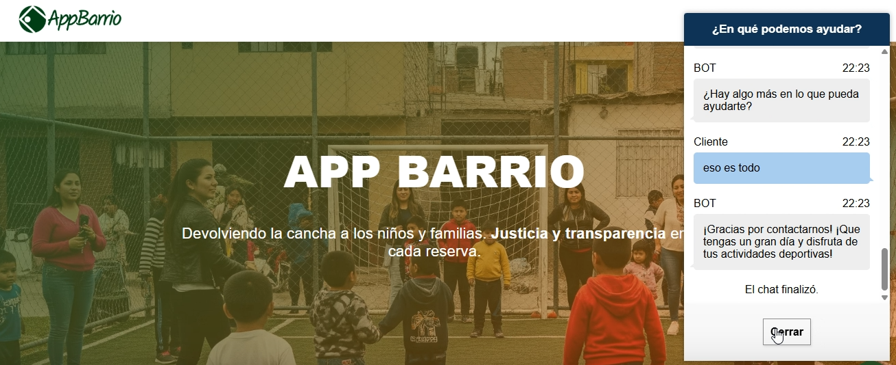
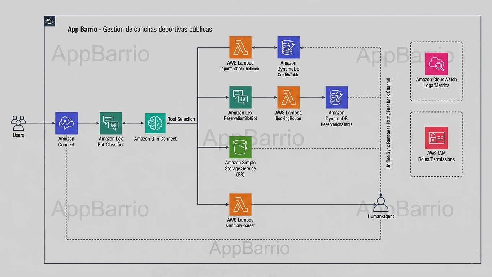

# AppBarrio: agente de IA para reservar canchas comunitarias

Arquitectura serverless en AWS para gestionar reservas de canchas comunitarias mediante conversación natural (chat). Usa el patrón **Orquestador + Ejecutor**: **Amazon Q in Connect** razona y orquesta, y **Amazon Lex V2** ejecuta la lógica transaccional sobre **AWS Lambda** y **DynamoDB**.

> proyecto presentado en la Hackathon ENEISOFT Edición XV (noviembre de 2025), donde recibió un reconocimiento por aporte tecnológico.

AppBarrio nace de un problema real: la dificultad de acceder a espacios deportivos públicos de forma organizada. La solución permite consultar disponibilidad, precios, reglamentos y realizar reservas desde una interfaz conversacional.

📝 **Artículo: [Dev.io](https://dev.to/sofia_torresvilca_10ed7f/appbarrio-agente-de-ia-con-amazon-connect-y-lex-patron-orquestador-ejecutor-32ch)**

## Interfaz de usuario

La interfaz web, basada en la plantilla oficial del workshop de integración de Amazon Connect y personalizada con la identidad visual de AppBarrio, incorpora un chat en tiempo real que guía al usuario desde la consulta inicial hasta la confirmación de la reserva, mediante Amazon Q y Lex.

<div align="center">

</div>

<div align="center">

|                Confirmación de Reserva                |                 Cierre de Chat                 |
| :---------------------------------------------------: | :--------------------------------------------: |
|  |  |

</div>

## Arquitectura del sistema

El diseño sigue el patrón **Orquestador + Ejecutor**: la IA interpreta y decide, y un bot determinista ejecuta. Así se separa el razonamiento de la IA de la ejecución transaccional.

<div align="center">

</div>

### Roles de cada pieza

| Pieza | Rol | Qué hace |
| :-- | :-- | :-- |
| **Amazon Q in Connect** | Agente orquestador | Interpreta el mensaje del usuario. Si es una consulta (precios, reglamento, horarios), responde con RAG sobre documentos en S3. Si es una reserva, deriva al bot transaccional. Si hace falta, escala a un agente humano. |
| **`bot-reservas`** (Lex V2) | Ejecutor transaccional | Bot tradicional con intents y slots. Recoge DNI, tipo de cancha, fecha y hora, y ejecuta la lógica de negocio mediante Lambda. |
| **`bot-clasificador-q`** (Lex V2) | Conector | Bot que Amazon Connect requiere para integrar Amazon Q in Connect. No contiene lógica de negocio propia. |
| **AWS Lambda + DynamoDB** | Lógica y datos | Consulta de saldo, reservas y formateo de resúmenes. |

### Decisiones de diseño clave

**¿Por qué Amazon Q in Connect como orquestador y Lex V2 como ejecutor?**

- Q in Connect interpreta lenguaje natural y decide qué camino seguir (responder con RAG, reservar o escalar).
- Para recoger datos estructurados (DNI, fecha, hora), un bot con slots valida cada dato y reduce el riesgo de que un LLM lo invente o lo interprete mal.
- Cada pieza hace lo que mejor hace: el LLM conversa y decide; el bot transaccional ejecuta de forma predecible.


**¿Por qué funciones Lambda separadas?**

- Por responsabilidad única: si la consulta de saldo falla, el módulo de reservas y el formateador de resúmenes siguen operando.

## Características principales

- **Atención con IA generativa:** respuestas en lenguaje natural sobre reglamentos, precios y horarios, con RAG sobre documentos PDF en S3 mediante Amazon Q in Connect.
- **Reservas guiadas:** flujo conversacional con Amazon Lex V2 para recopilar datos de forma estructurada (DNI, tipo de cancha, fecha, hora).
- **Serverless:** despliegue automatizado de la capa de aplicación con AWS SAM. Lambda y DynamoDB (on-demand) no cobran por capacidad ociosa; Amazon Connect y Q in Connect tienen su propio modelo de precios.
- **Mínimo privilegio (PoLP):** políticas IAM acotadas por función Lambda y tabla DynamoDB.

## Tecnologías

| Categoría | Tecnología |
| :-- | :-- |
| **Compute** | AWS Lambda (Python 3.13) |
| **Database** | Amazon DynamoDB (On-Demand) |
| **Conversational AI / RAG** | Amazon Connect, Amazon Q in Connect, Amazon Lex V2 |
| **Storage** | Amazon S3 |
| **Frontend** | HTML, CSS, Amazon Connect Chat Widget |
| **IaC & Ops** | AWS SAM, AWS IAM, Amazon CloudWatch |

## Alcance y limitaciones

Este proyecto es un **prototipo**, no un sistema listo para producción.

- No medí costos reales, latencia ni comportamiento bajo carga.
- La base de conocimiento es pequeña (FAQ, precios y reglamento); no sé cómo se comportaría con cientos de documentos.
- No se incluye autenticación de usuarios: la identificación es por DNI dentro del flujo conversacional.
- La calidad de las respuestas de Q in Connect no se evaluó de forma sistemática.
- Parte de la configuración (Connect, Q, bots de Lex) es manual; ver la siguiente sección.

## Qué despliega SAM y qué se configura a mano

`sam deploy` despliega la **capa de aplicación**: funciones Lambda, tablas DynamoDB, roles IAM y permisos de invocación. Estos recursos **no** se crean con `sam deploy` y se configuran por separado:

- La instancia de Amazon Connect (el despliegue solicita su ARN).
- El asistente y el agente de Amazon Q in Connect, y los documentos en S3 que usa para RAG.
- Los bots de Amazon Lex V2 (`bot-reservas` y `bot-clasificador-q`).
- El widget de chat de Connect y la interfaz web.

El paso a paso está en [Documentación Técnica Detallada](docs/TECHNICAL.md).

## Estructura del repositorio

```text
📦 Amazon-Connect-Orchestrator-Executor
├── 📁 functions
│   ├── 📁 check-balance       # Lambda: consulta de saldo
│   ├── 📁 router              # Lambda: fulfillment de reservas (Lex V2)
│   └── 📁 text-parser         # Lambda: formateo de resúmenes (Amazon Q)
├── 📁 events                   # Eventos de prueba para sam local invoke
├── 📁 assets                   # Imágenes del proyecto
├── 📁 docs
│   └── TECHNICAL.md            # Documentación técnica detallada
├── template.yaml               # Plantilla IaC de AWS SAM
├── samconfig.toml              # Configuración de despliegue SAM
└── README.md
```

## Despliegue rápido (AWS SAM)

### Prerrequisitos

- AWS CLI v2
- AWS SAM CLI
- Python 3.13+
- Cuenta de AWS con permisos IAM adecuados
- Una instancia de Amazon Connect ya creada (ver la sección anterior)

### 1. Clonar el repositorio

```bash
git clone https://github.com/sofia-torres-v/Amazon-Connect-Orchestrator-Executor.git
cd Amazon-Connect-Orchestrator-Executor
```

### 2. Construir y desplegar

```bash
sam build
sam deploy --guided
```

## Documentación técnica

> 📖 ¿Quieres ver los payloads JSON, esquemas de DynamoDB, pruebas locales e integración paso a paso?
>
> Consulta la **[Documentación Técnica Detallada](docs/TECHNICAL.md)**.

---

**Desarrollado por [Sofía Torres](https://github.com/sofia-torres-v)** · [LinkedIn](https://www.linkedin.com/in/sofia-torres-v/) ✨