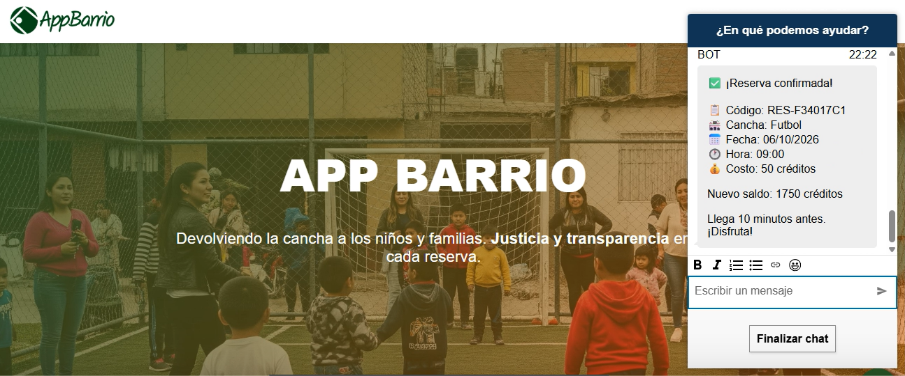
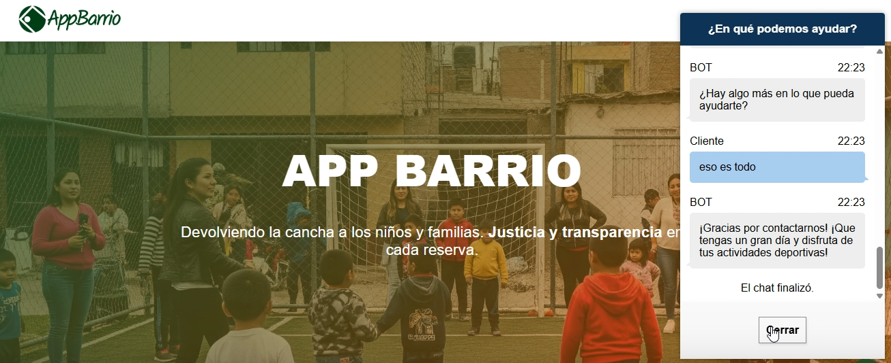
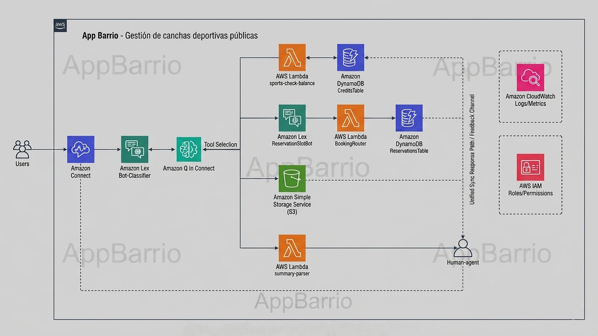

#  AppBarrio: agente de IA para reservar canchas comunitarias

Arquitectura backend serverless en AWS para la gestión de reservas de canchas comunitarias mediante conversación natural (Chat). Integra **Amazon Connect**, **Amazon Q in Connect** y **Amazon Lex V2** sobre **AWS Lambda** y **DynamoDB**.

AppBarrio nace de un problema real: la falta de un sistema accesible para reservar canchas deportivas públicas. La solución permite consultar disponibilidad, precios, reglamentos y realizar reservas a través de una interfaz conversacional inteligente, sin apps adicionales ni formularios complejos.

## Interfaz de usuario

La interfaz web está basada en la plantilla oficial del workshop de integración de Amazon Connect, personalizada con la identidad visual de AppBarrio. Integra el script del widget de chat, permitiendo a los usuarios interactuar en tiempo real con el flujo conversacional impulsado por Amazon Q y Lex.

<div align="center">

</div>

## Flujo conversacional

El chatbot guía al usuario desde la consulta inicial hasta la confirmación de reserva mediante conversación natural:

<div align="center">

|                Confirmación de Reserva                |                 Cierre de Chat                 |
| :---------------------------------------------------: | :--------------------------------------------: |
|  |  |

</div>

## Arquitectura del sistema

El sistema implementa un **Patrón Híbrido Clasificador + Especialista (Router/Dispatcher Pattern)**, separando el razonamiento de IA de la ejecución transaccional determinista.

<div align="center">

</div>

### Decisiones de diseño clave

**¿Por qué Amazon Q in Connect + Lex V2 (2 Bots)?**

- `bot-clasificador-q` **(Agente Orquestador):** actúa como interfaz agéntica. Amazon Q razona sobre el mensaje, responde preguntas de S3 (RAG) o decide qué herramienta/bot invocar.
- `bot-reservas` **(Bot Transaccional):** recopila de forma estructurada los datos del usuario (DNI, fecha, hora) sin alucinaciones de LLM ni consumo innecesario de tokens.

**¿Por qué Amazon Q in Connect y no Amazon Bedrock?**

- Para un volumen reducido de documentos (FAQ, precios, políticas), Q in Connect ofrece RAG nativo integrado directamente con Amazon Connect sin costos adicionales de vectorización.

**¿Por qué funciones Lambda separadas?**

- Siguiendo el principio de responsabilidad única: si la consulta de saldo/disponibilidad falla, el módulo de reservas o el parser de resúmenes sigue operando.

## Características principales

- **Atención agéntica e inteligente:** respuestas en lenguaje natural sobre reglamentos, precios y horarios mediante Amazon Q in Connect realizando RAG sobre documentos PDF en S3.
- **Reservas automáticas:** flujo conversacional guiado con Amazon Lex V2 para recopilación estructurada de datos (DNI, fecha, hora, tipo de cancha).
- **Arquitectura serverless event-driven:** despliegue automatizado con AWS SAM, escalabilidad automática y cero costo en reposo.
- **Escalamiento a agentes humanos (handoff):** generación automática de resúmenes de conversación con Lambda para transferir contexto completo al soporte humano.
- **Mínimo privilegio (PoLP):** configuración estricta de políticas IAM por función Lambda y tabla DynamoDB.

## Tecnologías

| Categoría                   | Tecnología                                         |
| :-------------------------- | :------------------------------------------------- |
| **Compute**                 | AWS Lambda (Python 3.13)                           |
| **Database**                | Amazon DynamoDB (On-Demand)                        |
| **Conversational AI / RAG** | Amazon Connect, Amazon Q in Connect, Amazon Lex V2 |
| **Storage**                 | Amazon S3                                          |
| **Frontend**                | HTML, CSS, Amazon Connect Chat Widget              |
| **IaC & Ops**               | AWS SAM, AWS IAM, Amazon CloudWatch                |

## Estructura del repositorio

```text
📦 appbarrio-aws-serverless
├── 📁 functions
│   ├── 📁 check-balance       # Lambda: consulta de saldo/disponibilidad
│   ├── 📁 router              # Lambda: fulfillment de reservas (Lex V2)
│   └── 📁 text-parser         # Lambda: formateo de resúmenes (Amazon Q)
├── 📁 assets                   # Imágenes del proyecto
├── 📁 docs
│   └── TECHNICAL.md            # Documentación técnica detallada
├── template.yaml               # Plantilla IaC de AWS SAM
├── samconfig.toml              # Configuración de despliegue SAM
├── LICENSE
└── README.md
```

## Despliegue rápido (AWS SAM)

### Prerrequisitos

- AWS CLI v2
- AWS SAM CLI
- Python 3.13+
- Cuenta de AWS con permisos IAM adecuados

### 1. Clonar el repositorio

```bash
git clone https://github.com/sofia-torres-v/appbarrio-aws-serverless.git
cd appbarrio-aws-serverless
```

### 2. Construir y desplegar

```bash
sam build
sam deploy --guided
```

## Documentación técnica

> 📖 ¿Quieres ver los payloads JSON, esquemas de DynamoDB, pruebas locales e integración paso a paso?
>
> Consulta la **[Documentación Técnica Detallada](docs/TECHNICAL.md)**.

## Licencia

Este proyecto está bajo la [Licencia MIT](LICENSE).

---

**Desarrollado por [Sofía Torres](https://github.com/sofia-torres-v)** ✨
